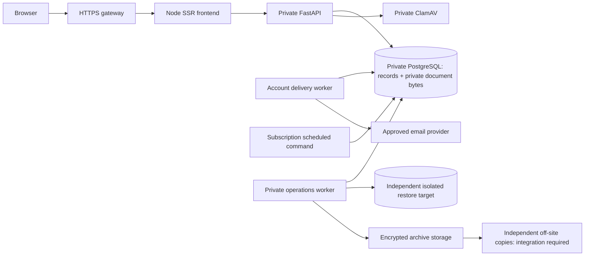

# i-Save release-readiness review

**Implementation update:** the production-gateway/launch-mode task is implemented in the current worktree; see the addendum below and [deployment runbook](production-gateway-runbook.md). The original review findings are retained as baseline evidence. The goal remains the **full platform**; no informational-only launch was selected, and no normal services or launch mode were changed.

Review date: **25 October 2026**. Source baseline: **`0b33a30`**. This is a code, configuration, migration and operational-evidence review, not a security certification or launch approval. No implementation fixes are included.

## Overall readiness

**Not ready for an unrestricted public application or financial-service launch.** Many connected workflows are implemented and have meaningful isolated PostgreSQL, browser and failure-case evidence. The missing production gateway, email delivery, operational recovery arrangements and policy approvals prevent treating that evidence as production readiness.

A smaller informational release is an option **only if explicitly chosen by the owner**. The goal remains the full platform. The original review found no enforceable restricted release mode; the addendum records its implementation as a safeguard, not a change to launch scope. Hiding navigation alone remains insufficient.

The current normal installation is a local development environment, not an internet-facing production deployment. Its development settings are findings about deployment preparation, not evidence of a public compromise.

## Evidence and preservation

Inspected source includes the authentication bridge and session services; resource and workflow routers; registration, evidence/scanner, membership, plan, savings, subscription, withdrawal, report, account, content, support, campaign and operations services; ORM models and Alembic history; Dockerfiles, Compose overlays, `render.yaml`, public routes, portal navigation and validation documents. Findings below identify source locations so they can be reproduced independently of milestone summaries.

Read-only inspection of the normal database found:

- Schema at **`0018_operations`**, passing the application's current-schema check. No migration was run.
- One active administrator, no active Staff/Finance/Member accounts in the role-count query. This does not establish a production operational roster.
- Baseline registration fee **USD20** and monthly subscription **USD5**, following-calendar-month start; due day unset. No effective published plan terms. Seven missing operational withdrawal-policy decisions.
- Savings separation `distinct_all`; subscription separation `recorder_separate`. Registration-fee same-person recording/verification remains separately approved when both permissions are held.
- No private application evidence rows; operations policy version zero, retention periods and backup schedule unset; no dashboard backup job. Historical private pre-migration backup/restore evidence is distinct from a scheduled operational backup.
- The runtime database role is a PostgreSQL superuser. `audit_events` has no non-internal immutability trigger.

Only scoped, read-only database queries were used. No normal login, uploads, receipts, financial actions or policy edits were exercised. No credentials, tokens, private links or document contents were captured. Intentionally untracked evidence folders were left intact. New synthetic checks used a network-disabled temporary container and an in-memory database, with no mounted normal storage.

Final Docker comparison confirmed all eight normal containers retained their original IDs, start timestamps and running/stopped states. Frontend, backend, PostgreSQL and scanner remain running and healthy; account/operations workers and the independent restore database remain running without dedicated health checks. **Mailpit was already stopped and remains stopped**; its retained old unhealthy status was not changed. Git inspection found no tracked implementation edits; only this report was added alongside the pre-existing untracked evidence folders.

## 1. Feature readiness

Classification applies to the stated scope, not every future capability. “Implemented and verified” means source inspection plus applicable local/isolated evidence; it does **not** imply hosted-production acceptance.

| Feature | Classification | Working scope and remaining boundary |
| --- | --- | --- |
| Public website | Implemented but needs configuration or approval | Redesigned pages, approved contacts and versioned public content are connected. Hosting, official legal copy and stale disclosures need attention. Contact provides office contact links, not an undocumented message-delivery form. |
| Public/staff-assisted registration | Implemented but needs configuration or approval | Pending persistence, duplicate-safe generic acknowledgement, consent, session-derived staff attribution, review/search/history. Production privacy/intake requirements must be approved; no login account, membership or payment is created on submission. |
| Private registration documents | Implemented but needs configuration or approval | PNG/JPEG validation, private PostgreSQL byte storage, fail-closed real scanning, protected downloads, replacement/review history and dedicated permissions. Production collection/retention approval is unset. PDFs are intentionally unsupported. |
| Membership approval/activation | Implemented but needs configuration or approval | Verified fee gate, configured review checks, distinct audited approval/activation and single-use password setup. Production delivery and authorised operational roster are not ready. |
| Plan drafts/publication/enrolment | Implemented but needs configuration or approval | Versioned drafts, explicit approval/publication, effective offers, immutable accepted snapshots and separate enrolment activation. No effective normal plan exists; actual complete terms need Admin approval. Existing interests are not enrolments. |
| Savings recording/reconciliation | Implemented and verified | Pending recording, separate verification/reconciliation, append-only credits/reversals, ownership and currency-specific balances. Normal operational use still needs the production controls and multiple authorised actors below. Historical Verified rows are not automatically reconciled credits. |
| Recurring subscriptions/payments | Implemented and verified | Catch-up generation, preview/run, first-obligation deduplication, frozen fee/rate snapshots, separate recording/verification and receipts. Deployment must schedule the repeatable command. Due day remains unset; no overdue consequences are enabled. |
| Withdrawals | Implemented but needs configuration or approval | Request/reservation, notice, approval, manual payout evidence, verification and linked debit implemented. **Normal processing remains disabled** until operational policy is completed and published. No bank transfer integration is implied. |
| Financial reporting/CSV | Implemented and verified | Fees, subscription obligations/payments, savings credits, pending/discrepant contributions, linked reversals and withdrawal debits kept distinct; currency-separated totals and protected exports. Current reservations are not a historical “as of” accounting statement. Production reconciliation/sign-off remains required. |
| Staff administration/permissions | Implemented and verified | Individual overrides, effective capability descriptions, invitations, account status, last-admin protection and revocation. Actual Staff/Finance permit paths and separation-of-duties staffing require production-shaped acceptance. Some navigation entries remain unavailable. |
| Recovery/invitations | Implemented but needs configuration or approval | Generic, throttled recovery; hashed, expiring, single-use links; replacement and race protection; reset revokes sessions without reactivation. **External production mail adapter is not implemented**; credentials alone cannot enable it. |
| In-app notifications | Implemented and verified | Persistent owned messages, unread counts, read/unread updates, permission-safe links and transactional event deduplication. Essential email notices are not automatically dispatched by the account worker. |
| Essential external email notifications | Incomplete | Local manual delivery/retry views exist. Production adapter and an explicit automatic essential-notification dispatch design are still needed if automatic email is a launch promise. Pre-account applicants cannot receive an account notification. |
| Content/announcements/events | Implemented and verified | Immutable versions, private edits, review/publication/effective times, exact public-version routes, archive controls and scanned public images. Official content and publication authority need organisational sign-off. Publishing does not send a campaign. |
| Member support | Implemented and verified | Owned tickets, protected office replies/internal notes, status/history and search. No attachments, response SLA or guaranteed automatic closure. Staff require explicit supported capabilities. |
| Announcement email campaigns | Implemented but needs configuration or approval | Consent history, approval/queueing/scheduling, dispatch-time suppression, safe unsubscribe, retry/uncertain states verified locally. External provider, authenticated delivery/bounce/complaint handling and readiness remain blocked. No consent may be inferred/imported. |
| Scanner/retention/backup operations | Implemented but needs configuration or approval | Real private ClamAV, scoped previews/holds, encrypted consistent DB/document archives and independent restore checks. Live erasure is intentionally test-only; off-site protection, recovery objectives, key custody, scheduling and alerting are not complete. |
| Returns, bonuses, lending, automatic penalties, savings conversion, discretionary adjustments, unsupported refunds | Intentionally unavailable | No launch material or settings toggle should imply these operate. Subscription partial/advance payments and waivers remain unavailable without an approved supported workflow. |

### Actual roles, not an Admin-only demonstration

`backend/app/security/auth.py` defines role templates and current permission evaluation; workflow routers additionally enforce role ceilings. A visible role workspace is not evidence of operational authority.

| Identity | Implemented access | Coverage/operational limitation |
| --- | --- | --- |
| Administrator | Broad non-member-own capabilities, account/individual grants, settings, plan publication, subscription generation and operations | The sole normal active account cannot satisfy the default three-person savings or separate subscription verification rule. Admin success does not prove a Staff/Finance permit path. |
| Staff | Minimal default read template; explicitly granted assisted registration, application/document review, membership, plan review, support/content and relevant financial capabilities where allowed | Member directory navigation exists but `AuthenticatedWorkspace.tsx` connects `MembersDirectory` for Admin only. This is a real UI coverage gap despite backend `members:read`. Not every Admin screen is a Staff screen. |
| Finance | Minimal default financial reads; separately granted savings/subscription/withdrawal/report capabilities, subject to workflow role gates | No implicit settings, staff administration, content or membership approval authority. Subscription generation is Admin-only even if a Finance user holds that permission. |
| Member | Own overview, fees, plans, contributions/receipts, withdrawals, support, notifications and preferences | Ownership enforced server-side. Organisation reports remain office-only. Unconnected profile/security/plan-detail destinations must retain explicit unavailable states. |

Isolated tests cover many negative/positive permission cases. A final staging matrix must exercise **real Staff and Finance roles with limited grants**, revoked grants on subsequent requests, and the required distinct financial actors. Do not relax savings separation merely because same-person registration-fee verification was approved.

### Misleading or incomplete presentation

1. `src/routes/disclosures.tsx` calls its top section current guidance but says enrolment and reliable savings balances are unavailable. Both are implemented. Expanded historical prototype text also says there are no real accounts/transactions. It is labelled historical, but should not serve as official launch wording.
2. `privacy.tsx` and `terms.tsx` remain draft templates, explicitly awaiting review. Their collection, fee and prototype/service statements are not a complete accurate notice for national IDs, income/residence evidence and real services. Retain history privately; publish approved current text.
3. `backend/app/schemas/enrolment.py::WITHDRAWAL_TEXT` says withdrawal processing is unavailable “in this milestone”. Preserve existing accepted snapshots; clarify current capability and policy gating separately, and approve corrected wording for **future** terms.
4. The implemented Admin operations screen lacks a matching description entry in `AuthenticatedWorkspace.tsx`, so the shell can describe that working screen as awaiting implementation. Staff Members and several role-template destinations remain genuinely unconnected; do not advertise them as completed operational screens.
5. `docs/delivery-roadmap.md` still contains earlier statements that recovery, plans, ledger and communications are outstanding, and an unresolved-decision register repeating decisions subsequently agreed. Use this review and the later milestone documents together; reconcile the roadmap before release handover rather than reopening settled policies.

## 2. Prioritised launch blockers

Gates: **I** informational public site; **A** accepting applications/private evidence; **F** member/financial operation; **C** external campaigns. High means block the affected gate until resolved; medium means an explicit scoped release decision or fix is needed.

| ID / severity | Gates | Evidence, impact and proposed fix |
| --- | --- | --- |
| R1 — High: production transport/client identity | I/A/F/C | Backend Docker starts Uvicorn with `--no-proxy-headers`. `auth-server.ts` calls HTTP `backend:8000`; production auth/setup/recovery require HTTPS as observed by FastAPI. A forwarded HTTPS header alone still returns `400 https_required` in isolation. Build and test a trusted TLS/proxy chain, private API access, verified scheme/host and client identity. Never solve this by using development mode or trusting arbitrary forwarding headers. Verify Secure cookies behind the actual frontend proxy. |
| R2 — High: shared throttling and edge limits | A/F | `services/auth.py` counts login attempts, including successes, by account and `request.client.host`, with a ten-attempt/15-minute limit. The frontend bridge does not convey a trusted originating client, so users share the frontend server's IP budget. Registration/recovery have similar exposure. Add bounded trusted identity propagation, spoof protection, edge limits and realistic multi-user tests. Login/recovery bridges read the full text before checking their small body limit: enforce streaming/edge request limits too. |
| R3 — High: no production release profile or intake gate | I/A/F/C | Compose defaults to development/debug, example credentials, local origins and automatic migration on API startup. Normal dev flags were confirmed; no comprehensive production fail-fast validation exists. `render.yaml` describes only the frontend, omitting its backend and operational dependencies. Add validated production configuration, explicit launch modes, controlled migration job and artifact/configuration checks. An informational launch must block intake APIs as well as hide CTAs. |
| R4 — High: official wording/privacy approval | I/A/F/C | Draft legal pages and stale disclosures above are publicly reachable. Obtain organisation/legal approval appropriate to actual service scope, data collection and hosting jurisdiction; replace current public guidance without rewriting accepted terms or historical evidence. This review does not determine legal/regulatory compliance. |
| R5 — High: production email is unavailable | A/F/C | `services/invitation_delivery.py::get_invitation_mailer` permits only development, local HTTP origins, Mailpit/loopback SMTP and a test sender. All production configurations return `UnavailableMailer`. Implement an approved provider adapter, verified sender, HTTPS links, secrets and safe failure handling; then validate external delivery evidence privately. Account creation/recovery cannot depend on Mailpit in production. Campaign readiness additionally needs authenticated bounce/complaint handling or a documented provider-supported alternative. |
| R6 — High: recoverability and operational ownership | A/F | Local AES-GCM archives/independent restores are implemented, but no off-site destination, approved RPO/RTO, escrow, scheduled normal backup or alert escalation is established. Host/DB failure could lose live data and local archives together. Implement and independently restore an encrypted off-site copy, prove key recovery, establish monitoring/schedule and document cutover. Do not claim local encrypted archives are off-site protection. |
| R7 — High: database privilege/audit assurance | A/F | Normal application DB role is superuser; global `audit_events` has no immutability trigger. Financial ledger/history protections exist, but a compromised runtime role can undermine them. Separate migration, runtime, backup and restore privileges; protect global audit history and independently retain integrity evidence. Test supported writes, migrations and backups under restricted roles. No public audit-write endpoint was found; this is privilege/tamper-resistance risk, not proof of an exposed audit-deletion route. |
| R8 — High: privacy lifecycle/collection gate | A | Production document collection depends on an approved collection period and configured checks. Both original collection retention and newer scoped operations periods are unset. Destructive execution is deliberately test-only and covers limited superseded evidence/rejected-application identity fields, not all active documents/accounts/archives. Approve lawful scopes/holds/retention first; either provide an operated lifecycle or keep affected intake disabled. Unset must continue to mean no automatic deletion. |
| R9 — High: live financial authority/policy | F | No effective normal plans; withdrawals have seven operational-policy blockers. Savings requires three distinct actors and subscriptions a separate verifier, but normal has only Admin. Configure approved complete terms and explicit grants/roster; privately accept each actual role path. Keep withdrawal processing blocked until its policies are published. Do not import synthetic terms, rates or separation settings. |
| R10 — Medium: legacy API bypasses current catalogue semantics | I/A/F | Anonymous `/api/v1/plans` lists all legacy `SavingsPlan` rows, including inactive/unpublished rows: reproduced with an isolated synthetic row, HTTP200. Formal offers correctly use published terms, but the old API can expose a contradictory catalogue. Retire or permission/restrict legacy catalogue endpoints and test that only approved effective offers are public. Generic member/application/fee writes also need an explicit deprecation/access/audit decision; they are not the new consent/review workflow. They were **not** shown to bypass active membership or create confirmed savings. |
| R11 — Medium: essential notification delivery contract | A/F | `notify()` persists `delivery_state='Not requested'`; `account_worker.py` runs recovery and campaigns, not automatic essential notice emails. Manual authorised delivery exists. Document in-app-only behaviour, or implement a deduplicated essential delivery outbox before promising automatic email. Pre-account requests for information require an explicit office follow-up process. |
| R12 — Medium: release/security/operations assurance | I/A/F/C | No repository CI release gate found. Backend image includes tests and rehearsal modules; frontend build context includes non-Markdown evidence files unless excluded. Final frontend image copies only `.output`, so build-context inclusion alone does not prove runtime exposure. Use artifact allowlists, test-fixture exclusion, dependency/container/secret scanning, patch ownership and protected build provenance. Worker health/freshness, disk/DB capacity and signature-update alerts need implementation. No MFA/privileged step-up implementation was found; explicitly assess privileged-access protection before financial operation. |

### Security and integrity controls already present

- **Sessions:** random opaque tokens stored as hashes; server-side expiry/revocation; fresh active-account/permission checks per request; dummy password check for unknown users; row-lock protections against concurrent password/suspension/login changes. Frontend HttpOnly, SameSite Strict cookies; Secure flag depends on the observed HTTPS URL. Origin/custom-header checks protect browser writes; allowlisted server bridges keep bearer tokens out of ordinary browser API bodies.
- **Invitation/recovery:** hashed purpose-specific tokens, expiry, replacement invalidation, single use and locked consumption. Password length is 12–72 characters and at most 72 UTF-8 bytes. Reset revokes sessions and does not change role, membership or finances. Generic public acknowledgements and persisted throttles reduce enumeration; end-to-end timing/load and real proxy behaviour remain unverified.
- **Authorisation:** per-capability enforcement, member ownership, account/role guards, no self-escalation, serialized last-active-admin protection. Audit APIs require `audit:read`; report/export and evidence access have separate permissions. Review exact grants because an explicit capability grant can confer more than a role's template.
- **Uploads:** PNG/JPEG content decoding and limits (2 MiB, 16 megapixels), safe filenames, private storage, scanned bytes, evidence review/replacement history, protected audited download with no-store/nosniff protections. Scanner errors, timeout and unavailable/stale signatures fail closed. Synthetic scanner requires isolated test configuration. Antivirus reduces risk; it does not certify a document or prove its truth.
- **Money:** Decimal arithmetic, frozen fee/rate/settings snapshots, USD/ZWG separation, explicit transitions, row/advisory locks and unique request/reference constraints. Confirmation/ledger/audit posting is atomic; reversals link rather than rewrite history. Generic legacy contribution/verification/payment-completion routes are disabled where they could bypass current workflows. Registration fees and subscriptions never credit savings.
- **Communications:** notification ownership, transactional event deduplication, independent marketing consent, POST-confirmed unsubscribe (opening/prefetching a link does not unsubscribe), dispatch-time rechecks, and uncertain outcomes blocked from blind retry. SMTP acceptance is not inbox delivery.

The review did not perform penetration testing, broad fuzzing, dependency/container advisory scanning, a cryptographic audit, browser-assisted authenticated production testing or a compliance assessment. Baseline SSR exception logging was broad; the addendum includes hosted application error suppression. Infrastructure/aggregation log review remains outstanding. Do not infer absence of defects from passing workflow tests.

## 3. Actual hosting requirements

### Recommended architecture

Use an organisation-owned domain and HTTPS ingress; run the **Node SSR frontend and FastAPI backend as separate container services**, with only the frontend/gateway public. Use **managed PostgreSQL with encrypted storage, automated backups and PITR**, private network access and restricted identities. Run ClamAV and long-lived account/operations workers on private container compute with suitable memory and persistent volumes. Send encrypted application archives to independently controlled off-site object storage; manage keys separately. Add central redacted monitoring and alert escalation.

**Compatibility prerequisite:** current restore safety checks use `pg_control_system()`/cluster identity and create independent databases. Managed PostgreSQL may restrict these privileges. Validate/adapt the backup/restore identity contract against the chosen provider before committing to it; do not grant the web application superuser merely to retain the current tooling.

The diagram describes the target architecture; the external email and off-site integrations are **not currently implemented**.

### Lower-cost alternative

A single appropriately sized Linux VM can run the existing containers behind a TLS reverse proxy, with private Docker networks, encrypted persistent disks and separately controlled off-site backups. This avoids requiring several managed runtimes, but puts database, application and scanner in one failure/security domain. It requires active OS/container patching, database maintenance, monitoring, capacity management and recovery ownership; it is not highly available. Off-site restore testing remains essential. Size from measured load and scanner update peaks, not just idle application use. No provider prices were assumed.

| Component | Current requirement / production implication |
| --- | --- |
| Frontend | Node24 Docker runtime, TanStack Start/Nitro SSR, `node .output/server/index.mjs`; it is **not a static SPA**. Backend origin must be set privately. Public contacts/content also use the backend. A static informational export would be separate work. |
| API | Python3.12, FastAPI, SQLAlchemy/psycopg, schema head0018. Private API connectivity, trusted transport/client identity, debug off, strict origins and validated configuration. Replace per-replica automatic migration startup with a controlled release migration step. |
| PostgreSQL | Current local version16; persistent encrypted storage, capacity/connection budgets, restricted runtime role, controlled migration/backup roles. Private evidence bytes are in PostgreSQL (`bytea`), not a public asset directory or an already-implemented object store. DB growth and backup sizing include uploads. |
| Scanner | ClamAV daemon private port3310, persistent signature directory, outbound signature updates, freshness monitoring and failure-closed handling. No public scanner port. Official Docker guidance gives a 3GiB minimum; reserve additional update/reload headroom and capacity-test the complete system. |
| Account worker | Long-lived `python -m app.account_worker`, five-second polling; recovery/campaign jobs. Needs private DB and approved email adapter/configuration. Current Mailpit overlay is development-only, not a production worker blueprint. |
| Subscriptions | External scheduler invokes `python -m app.subscription_schedule`, optionally `--preview`/`--through YYYY-MM`; command is retry/concurrency safe. No deployed production scheduler is established. Log aggregate outcomes only; alert failures and unexplained catch-up. |
| Operations worker | Long-lived `python -m app.operations_worker`; private key mount, persistent encrypted archive directory, PostgreSQL client tools and isolated restore credentials. Linux `/dev/shm`/resource limits matter. Windows helper scripts are not a Linux hosting runbook. |
| Backup limits | Exported consistent DB snapshot, checksummed manifests, document hashes and AES-GCM encryption. Current archive limit defaults256MiB (configurable to1GiB); several buffers/inventories are memory-resident. Measure realistic document-volume behaviour before production. Archives and retained restore databases need capacity/disposal plans. |
| Email | Provider/sender/domain authentication, verified HTTPS setup/recovery/public links, secrets outside ordinary Admin settings, redacted delivery telemetry and safe uncertain-state handling. No production adapter exists today. Mailpit must not appear in production routing. |
| HTTPS and ingress | Certificates/renewal, trusted proxy chain, host/scheme validation, security headers, streaming request caps, rate limits and no direct public DB/API/scanner/restore ports. Validate cookie Secure behaviour at the real boundary. |
| Monitoring | External uptime, API readiness, DB capacity, worker heartbeat/queue age, scanner freshness, backup age/recovery results, SMTP failures, disk space and incident escalation. Current worker containers lack dedicated health checks. A healthy API does not prove workers or backups are healthy. |
| Storage/secrets | Persistent DB, scanner signatures and encrypted archives; isolated restore storage. Encryption key in private secret storage with independent recovery custody. Avoid ephemeral-only/serverless hosting for the current scanner/worker/filesystem implementation. No Redis is currently required. |
| Availability/scaling | Reports limit ranges/rows, CSV exports are bounded, campaigns have recipient/rate caps, recovery processing scans active-account hashes. Load and memory tests are still needed. Multiple replicas require controlled migrations and consistent trusted-client/rate-limit semantics. |

Official references checked for this review: [FastAPI trusted proxy deployment](https://fastapi.tiangolo.com/advanced/behind-a-proxy/), [ClamAV Docker requirements](https://docs.clamav.net/manual/Installing/Docker.html), and [PostgreSQL16 backup/recovery approaches](https://www.postgresql.org/docs/16/backup.html). Application `pg_dump` archives do not themselves provide WAL-based point-in-time recovery.

## 4. Decisions still required

Do **not** reopen settled direction: approved office contacts/Yolk House spelling; USD20 registration and USD5 monthly baseline; next-calendar-month subscription start; due day intentionally unset; separate fee/savings accounting; member-chosen weekly targets, USD/ZWG separately, eight calendar months; minimum fourteen-day withdrawal notice; registration same-person record/verify with both permissions; explicit marketing opt-in. A management-supplied exchange-rate draft is not approval to publish it.

| Group | Remaining decision | Admin configuration vs infrastructure/development |
| --- | --- | --- |
| Hosting/domain/provider | First launch scope: information only, applications, or operational services after gates; organisation-owned domain/account, approved budget envelope, operational owner and hosting/data region | Owner decision. Production deployment profile and launch-mode enforcement are developer work. Domain/TLS and private networks are infrastructure, not business settings. |
| Hosting/domain/provider | Email provider, authorised sender/domain and delivery/bounce requirements; off-site storage provider/account and independent location | Owner/provider choice; credentials in secret storage. Production adapters/integration require development, not an Admin toggle. |
| Business-policy approvals | Complete real plan terms and publication; operational withdrawal decisions (mode, limits, methods, approval levels, separation, cancellation and failure handling) | Existing versioned Admin workflows; leave blocked until explicitly published. Do not import rehearsal policy. |
| Business-policy approvals | Actual Staff/Finance authority roster and acceptance of the restrictive savings/subscription separation defaults, or an explicitly approved replacement | Supported individual grants and versioned settings; multi-actor acceptance needed. No inference from registration-fee policy. |
| Business-policy approvals | Subscription due day/stop rules and refund or unsupported payment policies **if these features are wanted** | Due day can remain unset without blocking current monthly obligations. No overdue penalties, billing-stop behaviour, refunds, partial/advance payments or waivers should be invented. Some require future development, not only settings. |
| Business-policy approvals | Final configured membership-review/document checks and an office process for pre-account follow-up; approved public content/publishing responsibility | Existing business/document settings and permissions where supported; pre-account automatic communication is not implemented. |
| Privacy/retention/legal | Approved public terms/privacy/disclosures, lawful sensitive-data collection, hosting/cross-border handling, document/identity scope periods, holds, access responsibility and disposal obligations | Legal/management approval; scoped settings exist but periods remain unset. General production disposal/account/financial/archive lifecycle remains incomplete. Financial/audit history must not be erased by a blanket rule. |
| Backup objectives/key custody | RPO/RTO, backup frequency and retention, independent off-site ownership, recovery-test cadence, incident owner and encryption-key escrow/recovery custodians | Schedule/scoped policy publication where supported; key custody/off-site automation/alerts are infrastructure and development work. Do not store keys in Admin business settings. |

Benefits/returns/penalties and other intentionally unavailable features need no decision to launch a narrower supported service; keep them unavailable and out of promises.

## 5. Validation status

### Applicable existing evidence, not newly rerun totals

The latest operations artifacts and `docs/private-document-operations.md` record:

| Existing run | Passed | Failed | Skipped | Qualification |
| --- | ---: | ---: | ---: | --- |
| Full isolated PostgreSQL backend | 662 | 0 | 10 | Exit0. SQLite-only concurrency variants skipped; PostgreSQL counterparts ran. |
| Final affected backend | 57 | 0 | 1 | Exit0. Includes five permission-denial tests added after full collection and the final cache-header refinement. Therefore no claim that the final tree had another complete full run. |
| Full frontend | 163 | 0 | 0 | Recorded milestone run. |
| Isolated browser checkpoints | 18 | 0 | 0 | Scanner, protected upload/download, operations, backup/restore and UI. These are checkpoints, not an additional pytest suite. |
| Worker fault/concurrency checkpoints | 3 | 0 | 0 | Missing-key failure, concurrent claiming, unsafe restore target refusal. |
| TypeScript / production Docker builds | Successful | 0 reported | — | Recorded operations milestone; not a hosted-production test. |

Earlier failed operations runs remain retained evidence and were corrected before the successful runs above. Earlier financial, document, account, content/support and campaign rehearsals remain useful workflow evidence; counts are not additive and cannot prove production email, real proxy behaviour or role staffing. See the corresponding milestone documents rather than repeating completed manual financial tests.

### Checks run during this review

| Check | Result |
| --- | --- |
| Normal schema/configuration/role counts | Read-only check passed; findings recorded above. No migration or write command. |
| Isolated legacy catalogue probe | Reproduced defect: unauthenticated200 exposes inactive unpublished legacy row. Temporary container, network disabled, memory-only database. |
| Isolated production proxy probe | Reproduced deployment defect: HTTP request plus forwarded HTTPS still400 `https_required`. No normal authentication attempt. |
| Focused frontend tests | **49 passed, 0 failed, 0 skipped**, four files: `auth-server.test.ts`, `auth.test.tsx`, `document-operations.test.tsx`, `financial-operations.test.tsx`; original test command exit0. |
| Anonymous normal browser smoke | **9 checks passed:** homepage, contact, plans, privacy, disclosures return200; Admin portal redirects to login; auth identity, operations and financial-report APIs return401. No authenticated or mutating requests. |
| Full backend/frontend/build/browser regression | **Not rerun** for this documentation-only review. Existing results above remain historical evidence, not new claims. |

The first isolated probe needed a corrected shared-memory SQLite test harness; the corrected probes exited0 and reproduced the findings. Default browser launch attempts did not complete; the final smoke used the repository-documented Chrome executable and bounded DOM-load waits successfully. These were review harness issues, not demonstrated application failures.

Still unrun: production-shaped HTTPS/client-IP concurrency/spoof tests, actual limited Staff/Finance multi-actor acceptance, provider email/inbox/bounce verification, managed-Postgres compatibility, off-site/key-loss restore and timed RPO/RTO rehearsal, realistic load/capacity, full security/dependency/container/secret scans, formal accessibility/screen-reader testing, legal/regulatory sign-off and live incident/cutover rehearsal. No manual financial flow was repeated.

## 6. Ordered launch and rollback checklist

1. **Approve scope and owners.** Choose the first release gate, nominate security/operations/financial approvers and record the known unavailable services. Reconcile roadmap claims against this review.
2. **Implement the bounded production gateway/configuration task below.** Fix trusted scheme/client identity and shared rate limits, validate production configuration, control migrations and provide enforceable informational-only mode. Do not simply expose local Compose or the frontend-only Render file.
3. **Prepare a reproducible release artifact.** Pin/test dependencies and images; run secret/advisory/container scans and release checks. Exclude rehearsal entry points, tests and local evidence from release artifacts/build contexts without deleting retained local evidence. Record source revision, image digests and configuration names, never secret values.
4. **Build staging with separate synthetic storage.** Use different DB/volumes, credentials, keys and mail sandbox. Test trust boundaries, limited roles and real worker/scheduler health. Do not clone normal PII/accounts into a public staging environment. If a private recovery copy is necessary, isolate it from applications/email and treat copied session hashes/links as sensitive.
5. **Assert production contamination guards for every service/job.** Canonical `APP_ENV=production`, debug off; no test clock, synthetic scanner, test-only erasure or `isave_test` database; no Mailpit/localhost setup-link routing or test sender. Inspect all workers as well as API/frontend. Inventory TEST ONLY/synthetic accounts, campaigns, documents, rates and policies; require a clean approved production dataset, not automatic deletion from normal records. No fixture modules or rehearsal secrets in images. Do not automatically publish seeded drafts or consent.
6. **Complete infrastructure and recovery gates.** Private networking, restricted DB identities, encrypted live storage, key escrow, independently stored archives/PITR, alerts and restore-runbook ownership. Restore to a separate target and verify DB plus document hashes. Prove restore tooling works with provider privileges and realistic size limits.
7. **Complete data/policy/legal gates for the selected scope.** Approve current public copy. For applications approve privacy/document collection and follow-up. For finance configure actual terms, role separation, reports and approved withdrawal policy only if launching withdrawals. Keep other actions blocked. No automatic overdue labels or penalties with unset rules.
8. **Run release regression against staging.** Full backend PostgreSQL suite, frontend, TypeScript, production builds and targeted real-browser acceptance. Report failures/skips/unrun distinctly; include two-client limits, forged proxy headers, Secure cookies, account suspension, token races, scanner outage, outbox failures, ledger/report agreement and backup alerts. Reuse existing isolated financial evidence; repeat only where deployment or code changes affect it.
9. **Private acceptance and approval.** Organisation owner verifies official public pages; actual Staff/Finance test supported restricted tasks and ownership. Use controlled staging accounts, not real-password resets or real transfers. Explicitly approve launch scope, remaining limitations and rollback authority.
10. **Controlled rollout.** Freeze writes if required, take a private backup and independent restore/preservation checkpoint before any new normal migration. Run one controlled migration job; verify head, immutable histories, counts/checksums and readiness before traffic. Deploy reviewed images/configuration. This review did none of these activation actions.
11. **Observe the owner-approved rollout.** Select the release scope explicitly, using launch modes as safeguards while the full-platform blockers are resolved. Do not infer a decision to launch informational-only. Monitor auth failures/429s, application errors, queue ages, signatures, DB/disk, report differences and backup freshness. Do not enable campaigns or external email merely because content is published.
12. **Rollback safely.** Keep prior reviewed image/configuration digests and a maintenance/intake-disable path. Stop dispatch/financial writes if integrity is uncertain; preserve attempts and histories. Roll back binaries only when compatible with the current schema. Do not blindly downgrade financial migrations or restore over live data. Use a separately restored target, reconcile writes since the recovery point and obtain explicit cutover authorisation under the documented recovery procedure.

## Original gateway task scope (implemented; validation addendum follows)

**Production gateway and launch-mode hardening, with an isolated staging release profile.** Implement trusted HTTPS/client-identity propagation across ingress → Node SSR → FastAPI; reject forged forwarding headers; preserve per-account limits while eliminating the shared frontend-IP budget; enforce request-size limits and Secure cookies; add production fail-fast configuration and explicit informational-only API/UI gates; provide a controlled migration command/profile and clean release artifact checks. Add isolated tests for real proxy behaviour, multiple clients, spoofing, mode enforcement and forbidden test configuration. Do not provision hosting or migrate normal data as part of that task.

Then address the remaining application/financial gates in priority order: least-privilege/audit protection and recovery infrastructure, approved public/privacy wording, production account email, and authorised policy/role acceptance. The next task is not another business-feature milestone.

## Gateway and launch-mode implementation addendum

Implementation/validation: **25–26 October 2026**, uncommitted worktree following the baseline review.

The current worktree adds a standalone private hosted profile, authenticated gateway assertions, canonical HTTPS handling, request-scoped client identity, enforced launch modes and a protected legacy catalogue. No schema change, normal migration, normal restart, account reset, policy publication, external sending or public deployment is part of this task.

| Baseline finding | Current status |
| --- | --- |
| R1 transport/identity | Implemented and isolated-tested. Nginx replaces assertions, Node validates/canonicalises them and FastAPI authenticates the private hop before accepting HTTPS/client identity. Ordinary forwarded headers remain untrusted. Secure cookies and canonical redirects tested. Normal installation remains unchanged. |
| R2 shared throttling/body bounds | Client addresses are request-scoped and shared PostgreSQL counters apply across replicas. Auth bodies are stream-bounded. API-only edge limits exclude assets and logout; a browser-discovered asset/logout budget collision was fixed. Supported topology is one direct TLS gateway; extra HTTP proxies/multiple gateways require explicit integration. |
| R3 production profile/intake gate | `compose.staging.yaml`, private file-based settings, Node startup preload/backend validation, explicit migration job, persistent storage and server-enforced informational/applications/full modes implemented. This is a portable staging definition, not provisioned hosting or production approval. Hosted safe default is informational; local normal default stays full. |
| R10 legacy catalogue | Legacy reads now require `plans:read`; only effective published offers are public. No legacy rows or accepted terms were rewritten. Generic legacy write retirement/audit review remains outstanding. |
| Other blockers | R4–R9, R11 and the remaining R12 security/operations/acceptance work remain. Artifact exclusion and non-root hosted API improve R12 but do not replace dependency scanning, monitoring or hosted acceptance. |

The [runbook](production-gateway-runbook.md) documents exact trust boundaries, endpoint/mode inventory, persistent services, configuration, deployment/rollback and provider limitations. Production mail remains deliberately disabled. `full` mode cannot satisfy missing withdrawal policy, approve terms or bypass permissions.

### Implementation validation and preservation

| Run | Passed | Failed | Skipped | Scope |
| --- | ---: | ---: | ---: | --- |
| Full backend regression | 704 | 0 | 11 | Isolated PostgreSQL; original pytest exit0. Ten skips are SQLite-only concurrency variants whose PostgreSQL equivalents ran. One real-ClamAV integration case was not enabled in this gateway stack; its earlier operations evidence is retained, not claimed as a new run. |
| Final affected backend | 268 | 0 | 0 | Authentication, configuration, catalogue/drafts, registration documents, launch modes, PostgreSQL atomic throttling and read-only deployment fixture guards; pytest exit0. |
| Full frontend | 175 | 0 | 0 | 25files; includes actual Node-process hosted-log suppression and nested application-review controls. |
| Final affected frontend | 59 | 0 | 0 | Gateway, availability, logging, authentication and registration; includes final plain-language availability copy and document-versus-financial guards. |
| Browser/gateway checkpoints | 22 | 0 | 0 | Seven initial HTTPS/Admin checks, thirteen mode/proxy checks and two final rebuilt-frontend checks. Mixed real-browser and HTTP checkpoints, not additional pytest cases. |
| Rate/replica checks | 6 | 0 | 0 | API saturation, asset separation, logout under limiting; shared limits across two private frontend/API replicas and independent clients. |
| Startup checks | 8 | 0 | 0 | Six host/image preflight checks plus two actual API-image process checks: production tier refuses the prepared fixture database; explicit staging tier permits it. No records changed. |
| TypeScript/builds | Passed | 0 | — | TypeScript and hosted Node frontend/API/operations-worker builds, with no normal service activation. |

Counts are not additive. The full backend collection preceded the final hostname/repr validation refinements and configuration/worker/data-promotion guard additions; the final affected run covers those changes. A further full collection after that expansion was not repeated. The final full frontend run includes the last nested review guards. Broad historical financial browser suites were not repeated. No penetration, dependency/advisory/container security, external provider, public-host or real scanner integration run is implied by these numbers.

Initial runs exposed and corrected request cloning, availability placement around session/logout controls, old test expectations, a missing test-module import, absent PostgreSQL lifecycle-test configuration and the real asset/API rate-budget collision. The final gateway exempts assets and logout from the coarse API budget. Two sessions orphaned when failed automated logout contexts closed were **administratively revoked with a cleanup audit**; this is not represented as manual logout evidence. Successful automated logouts, including the saturation checkpoint, were separately verified. No active disposable Admin session remained at that checkpoint.

Known fixture promotion is blocked in production tier by read-only API/worker startup checks. Isolated staging explicitly permits fixtures while retaining production transport/configuration hardening. This does not replace checking unlabelled policies/data before promotion.

The isolated database held no financial source records after the checks. A controlled restart preserved hashes/counts for all **71 staging tables**. Final API/worker images exclude rehearsal modules/tests; the frontend browser bundle excludes gateway credentials/transport code. No images were published; intermediate local rehearsal build caches must not be promoted. Detailed synthetic logs/configuration remain private and excluded from Git/build contexts.

**Closure passed:** both newly created disposable projects are stopped and their persistent PostgreSQL volume is retained. All eight normal container IDs, start timestamps and running/stopped states matched the baseline after closure. Existing local Mailpit remains stopped. No normal SQL write, migration, restart, mode change, credential reset, policy publication or external delivery occurred. The intentionally untracked evidence folders were not changed or staged.

**Activation remains separate:** schema0018 is sufficient; no new migration exists. Matching frontend/backend deployment and the hosted configuration/tier/mode require a later explicit activation instruction. Provider networking/TLS acceptance, production policies, legal wording, account email, recovery infrastructure and least-privilege/audit protection remain blockers. There are no unresolved unexpected failures in the final checks, but the skips and unrun production checks above remain limitations.

**Next implementation task:** least-privilege database and audit hardening: separate runtime/migration/backup identities, global audit tamper protection, and backup/restore compatibility tests against the selected PostgreSQL service. Off-site recovery/key custody, approved legal/collection wording, production account email and actual operational acceptance remain separate launch gates.

## Database privilege and audit hardening — implementation checkpoint (superseded by activation below)

This addendum supersedes the preceding **next-task** recommendation, without
rewriting its historical validation. See [database-security-runbook.md](database-security-runbook.md)
for the exact privilege matrix, provisioning, migration, managed-provider limits,
credential rotation, independent restore and proposed activation procedure.

Implemented changes:

- Separate NOLOGIN schema owner, explicit migration login, API, account worker,
  subscription scheduler, operations-job worker and read-only backup identities.
  Hosted startup checks effective privileges, membership, ownership, function
  exposure, UTC sessions and audit guards. A privileged session cannot disguise
  itself with SET ROLE. New tables require reviewed grants, not automatic DML.
- Migration0019 protects global audit against UPDATE/DELETE/TRUNCATE with ALWAYS
  triggers and preserves actor foreign keys using RESTRICT. Runtime grants add a
  separate denial layer. Audit ORM details redact structured credential fields
  and URLs; original history is not rewritten. System events retain explicit
  provenance and null staff identities. Privileged owners/infrastructure remain
  outside this tamper-resistance boundary; external integrity evidence is absent.
- Hosted Compose mounts migration credentials only in maintenance. A prepared
  local activation overlay clears inherited privileged URLs and API automatic
  migration while preserving normal storage/network/business settings. Neither
  configuration has been activated normally.
- Backup jobs and full-data reading use different source connections. Verified
  TLS options survive PostgreSQL client execution. Managed recovery supports an
  independently prepared empty target owned by a non-superuser without CREATEDB;
  existing/nonempty targets cannot be overwritten. Restricted providers require
  private, endpoint-bound operator evidence of independent resource identities.

**Current normal-state evidence limit:** Docker's Linux engine and the normal
PostgreSQL/frontend/Mailpit TCP endpoints were unavailable at the start of this
work. They were not started. The earlier report's normal-superuser/no-audit-trigger
finding remains historical evidence, not a fresh privilege inspection. No normal
SQL, privilege, migration, credential, account, document, policy or service change
was made. A fresh read-only normal inventory is required before activation.

Actual-role testing instead uses two separately initialised persistent portable
PostgreSQL16 clusters, random private credentials and loopback-only test ports.
They are not normal databases, Windows services or hosted infrastructure. This
proves PostgreSQL cluster isolation, not physical off-site resilience. Synthetic
data and encrypted recovery evidence stay private and excluded from Git/builds.
The equivalent persistent Docker test definition is prepared; Docker-image and
selected-provider acceptance remain unrun while the engine/provider is absent.

Validation and closure are recorded below. R7 remains
a launch blocker for the normal installation until approved migration/credential
cutover and independent acceptance. R4–R6, R8–R9 and remaining R10–R12 obligations
are not waived: privacy/legal/collection approval, production account email,
off-site recovery/key custody/alerts, actual staff/finance coverage, operational
policies and hosted security/acceptance remain required.

### Validation results and limits

| Run | Passed | Failed | Skipped | Scope |
| --- | ---: | ---: | ---: | --- |
| Frozen full backend regression | 798 | 0 | 11 | Real isolated PostgreSQL16, original pytest exit0. Includes actual-login role denials, non-superuser provisioning/migration, concurrent provisioning/audit/subscriptions, restricted API financial posting/reversal and encrypted independent restore. |
| Final affected backend | 138 | 0 | 0 | Final column-restricted account-worker matrix, successful recovery and mocked campaign dispatch, denied snapshot/actor edits, audit protections, gateway/configuration and migration checks; original pytest exit0. |
| Earlier broad affected backend | 331 | 0 | 1 | Authentication, operations, lifecycle/startup, schema and role tests before the last worker restrictions; the skip is the existing real-ClamAV integration requirement. Counts overlap and are not additive. |
| Offline deployment checks | 2 | 0 | 0 | Actual Compose parser with dummy file paths: hosted credential mounts and prepared normal overlay. No expanded secrets/configuration printed and no services started. |
| Persistence/recovery closure | Passed | 0 | — | Both71-table inventories and private-document hashes unchanged after controlled restart; retained encrypted synthetic archive matches its checksum and independently restored manifest. Only portable test processes subsequently stopped. |

The full run preceded the last account-worker column reduction and five extra
focused cases. The final affected run covers that final change; another full
collection after it was not repeated. Ten full-run skips are SQLite-only
concurrency variants whose PostgreSQL counterparts ran. One skip needs a real
private ClamAV container, unavailable with Docker stopped. A mocked campaign
transport proves worker privileges/state transitions, **not a new Mailpit capture
or external email delivery**. No Mailpit service was started.

Diagnostic runs are retained privately: an initial PostgreSQL run found four
equivalent-instant UTC versus UTC+02 retry-response differences. Explicit UTC role
sessions and matching disposable bootstrap configuration resolved them. A later
run hit two stale settings-class instances because source changed during that
run; the subsequent frozen full run passed. The remaining warning is the existing
Starlette TestClient/httpx deprecation, not a failed test.

The exploratory full Windows/SQLite run was **653 passed, 26 failed, 106 skipped**,
before the migration-head/preflight corrections. Five representative bootstrap,
publication/retry, enrolment and withdrawal failures were independently reproduced
against unmodified HEAD in a private copy: existing SQLite transaction/timezone
limitations, not proof of PostgreSQL failure. Migration adoption/downgrade
preflights and current SQLite lifecycle checks then passed in the broad affected
run. A new all-SQLite full collection was not repeated, and existing SQLite
timezone/transaction parity issues remain unresolved; do not describe that suite
as passing.

Unrun here: Linux image builds/bounded-tmpfs backup execution, fresh browser/UI,
frontend/TypeScript builds (no frontend changes), real scanner/Mailpit integration,
managed-provider networking/role/TLS acceptance, and all normal activation checks.
Windows archive acceptance used actual PostgreSQL dump/restore and encryption
with a test-only subprocess adapter; it does not prove Linux resource limits.
The managed-style test uses a non-superuser with explicit role ADMIN/SET and
database ownership authority; it is not a Render deployment test.

**Closure:** final synthetic privilege inventories, regression diagnostics,
encrypted archive and test key custody evidence are private and excluded from
Git/build contexts. Both portable clusters are stopped with their directories
retained. Normal Docker services were never started, restarted or reconfigured;
normal credentials, data, business grants, documents and the intentionally
untracked evidence folders were not changed. No normal backup/migration/privilege
cutover was attempted, and no push, merge or external sending occurred.

**Exact next task:** obtain explicit approval for a controlled normal database
security activation: fresh read-only identity/grant/service inventory, private
backup plus independent restore/preservation checks, migration0019, reviewed
ownership/grant changes, private per-service credentials and only the necessary
API/worker cutover. Preserve each recorded service state, including stopped
Mailpit. Do not perform destructive denial tests on normal audit data; use the
read-only verifier after isolated negative acceptance. Selected-provider
compatibility and the remaining email/off-site/privacy gates follow separately.

## Controlled normal database-security activation ? 27 October 2026

This supersedes the preceding prepared-only database-security status and its
normal-activation next task. The owner explicitly authorised this cutover.
[Complete evidence, operating commands and rollback](database-security-activation.md)
are recorded separately; [role responsibilities](database-security-runbook.md)
remain the deployment contract.

**Result: local normal activation passed.** Fresh inspection confirmed the old
superuser application role, 71 owner-held tables, schema0018 and no global audit
protection triggers. After isolated acceptance, a private encrypted backup,
independent restore and0019 rehearsal, only normal API/account/operations writers
were quiesced. Frozen-source preservation passed before migration. The normal
schema is now `0019_database_audit`; NOLOGIN `isave_owner` owns application objects,
and each runtime authenticates directly as its restricted purpose role.
Migration credentials are absent from runtime containers; API startup does not
migrate. Existing application accounts, grants/overrides, sessions, private
files, accepted terms, policies and financial records matched pre-cutover row,
document and sequence fingerprints, with only the Alembic revision changed.

| Check | Passed | Failed | Skipped | Evidence/scope |
| --- | ---: | ---: | ---: | --- |
| Corrected full Linux PostgreSQL regression | 803 | 0 | 11 | Original pytest exit0; PostgreSQL16, production operations/test Python3.11 toolchain. |
| Corrected affected actual-role suite | 91 | 0 | 0 | Non-additive subset; separate authentication, denied DDL/audit tampering, worker scope, races, restricted backup/restore. |
| Linux tmpfs/file-size refusal | Passed | 0 | 0 | Actual bounded subprocess execution and oversized-output failure, no normal target. |
| Normal backup/restore/migration rehearsal | Passed | 0 | 0 | Encrypted snapshot, distinct cluster identifiers, row/document/sequence agreement and successful0019/role rehearsal. |
| Actual normal cutover and runtime verification | Passed | 0 | 0 | API/account/operations/backup role checks; scheduler startup without generating obligations; runtime secret isolation. |
| Post-cutover restricted backup/recovery | Passed | 0 | 0 | Read-only source login and independent nonsuperuser restore; retained copy plus next empty target prepared. |
| HTTP smoke and service preservation | Passed | 0 | 0 | Homepage/ready/public contacts200; anonymous identity/Admin401; unchanged frontend/database/scanner/recovery starts and stopped Mailpit. |

The first Linux collection was802passed/1failed/11skipped (exit1), preserved as
historical evidence. The failure was the test image installing PostgreSQL17
client tools: restore emitted `transaction_timeout`, unsupported by server16.
A synthetic independent reproduction confirmed it. The image now matches the
operations PostgreSQL16 toolchain; the corrected affected and full collections
above passed before normal cutover. Five extra role-boundary checks explain the
change from the earlier798-pass full suite to803. The11skips are10SQLite-only
concurrency variants (PostgreSQL counterparts ran) and opt-in real ClamAV
integration. Existing all-SQLite parity failures are not claimed fixed.

Normal API, account worker and operations worker were the only services recreated;
operations alone was subsequently restarted to load its next empty recovery
endpoint. API/frontend/database/scanner are healthy; workers/recovery are running
without startup or permission errors. Mailpit remains stopped. No external mail,
policy publication, test-clock/scanner/fixture promotion or normal synthetic
transaction occurred. Both isolated Linux projects are stopped, their persistent
volumes retained, and privileged one-off maintenance containers removed. Private
archives, keys and evidence remain excluded from Git/build contexts; intentionally
untracked evidence folders were untouched. Nothing pushed or merged.

Frontend/browser/TypeScript checks were not repeated for database-only activation.
Required API/account/operations image builds, the PowerShell Compose helper syntax
and actual execution, and diff whitespace checks passed. Managed-provider role,
private-network/TLS and real hosted backup acceptance remain unrun; these local
results do not prove Render/provider compatibility or independent off-site storage.
Normal launch mode, withdrawal availability and all business settings are unchanged.

**Remaining launch gates:** provider/network/TLS acceptance; an implemented and
approved production account-email adapter/sender; independent encrypted off-site
backup custody, RPO/RTO and alerts; remaining business/privacy/legal approvals;
and the outstanding capacity/security/accessibility acceptance listed earlier.
Local database/audit least privilege is no longer an unactivated blocker. Next
infrastructure task is selected-provider staging acceptance of this exact role,
network/TLS, persistence and independent recovery layout, after the owner chooses
the provider and recovery custody/objectives. No hosting provisioning or external
sending is authorised by this activation.
